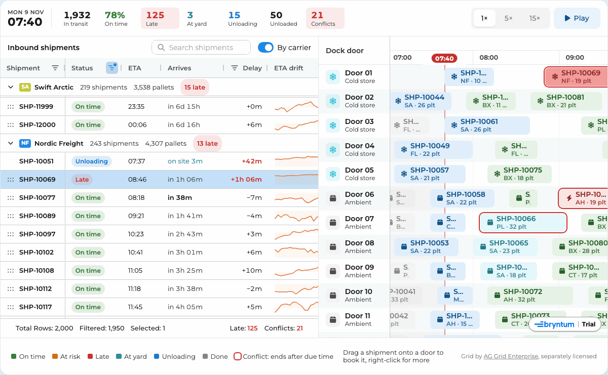
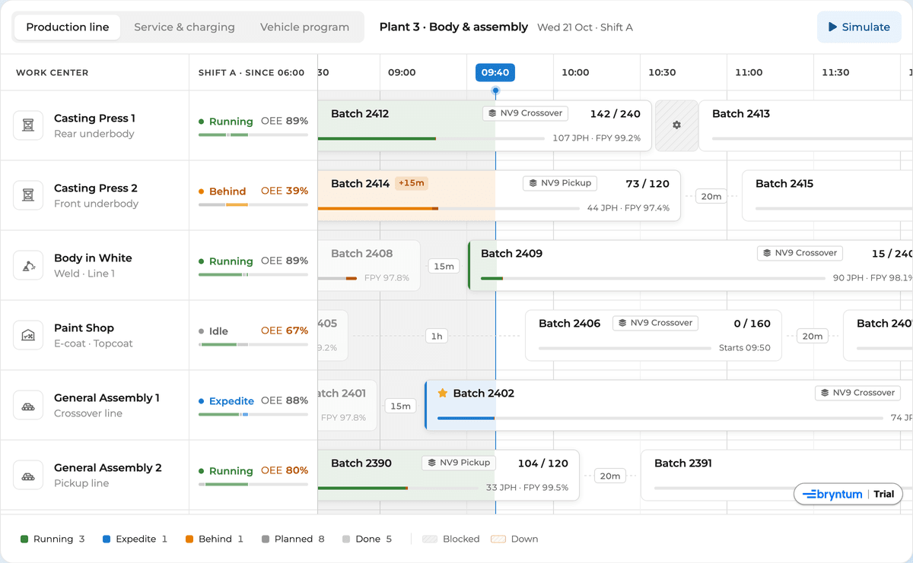

# Bryntum showcases

Real-world apps built with [Bryntum](https://bryntum.com) scheduling components: planning boards, live operations
dashboards and project plans, the kind of screens teams run their day on. Each showcase is a complete, polished app
you can open in the browser, read the source of, and copy as a starting point.

**[Open the live gallery →](https://bryntum.com/showcase/)**

* **Real use cases, not feature demos.** A distribution centre's dock doors, an EV factory's production line, a
  vehicle program plan: realistic data, a live simulation, and the interactions a planner actually needs
* **Plain JavaScript on the public npm packages.** No framework, no backend, no build magic: Vite, ES modules and
  the same `@bryntum` packages you install. Every app runs from static JSON in the browser
* **Built to be read.** One class per file, comments on the why, and a README per showcase that walks through how it
  works
* **Works everywhere.** Light and dark mode, desktop, tablet and phone

## The showcases

### Logistics Control Tower

<a href="https://bryntum.com/showcase/logistics-control-tower/">
  <picture>
    <source media="(prefers-color-scheme: dark)" srcset="gallery/logistics-control-tower-dark-1200.png">
    
  </picture>
</a>

The inbound control tower of a distribution centre. 2,000 shipments stream live into **AG Grid**, next to the 12
dock doors of the site in **Bryntum Scheduler**, whose scheduling engine books the unloading slots. When a truck runs
late, its slot moves and every slot after it at that door is pushed along; a slot that ends past its due time turns
into a conflict.

* Drag a shipment from the grid onto a door to book it, drag slots between doors, right-click to expedite
* Live KPIs, ETA drift sparklines, cold-chain temperatures, door downtime and an hourly utilization strip
* Shows how to run Bryntum and AG Grid side by side, kept in sync from one source of truth

**Built with** Scheduler (Enterprise tier), AG Grid Enterprise and AG Charts ·
**[Live demo](https://bryntum.com/showcase/logistics-control-tower/)** ·
**[Source and walkthrough](logistics-control-tower/)**

### EV Operations

<a href="https://bryntum.com/showcase/ev-operations/">
  <picture>
    <source media="(prefers-color-scheme: dark)" srcset="gallery/ev-operations-dark-1200.png">
    
  </picture>
</a>

One app, three views of an electric-vehicle operation: the **production line** with its work centers and batches, a
**service center** with service bays and DC fast chargers, and the **vehicle program** as a Gantt chart with phases,
dependencies, baselines and a milestone.

* Press Simulate and watch the day unfold: bars, status counts and the detail panel follow a moving "now"
* Click a bar for its details, double-click to edit it in a drawer, nudge it with Shift + arrow keys
* Shows how far Scheduler and Gantt can be styled and composed into one product-grade app

**Built with** Scheduler (Enterprise tier) and Gantt ·
**[Live demo](https://bryntum.com/showcase/ev-operations/)** ·
**[Source and walkthrough](ev-operations/)**

## Run it yourself

You need Node.js 22.22.2+, 24.15+ or 26+ (`nvm use` picks the pinned one).

```shell
git clone https://github.com/bryntum/showcases.git
cd showcases
npm install
npm run dev
```

Open the URL Vite prints to get the gallery, then pick a showcase. Without a licence key the Bryntum components run
in trial mode with a watermark, which is all you need to explore and learn.

Want to change things, run the tests or add a showcase of your own? See [CONTRIBUTING.md](CONTRIBUTING.md).

## Learn more about Bryntum

* The products: [Scheduler](https://bryntum.com/products/scheduler/), [Gantt](https://bryntum.com/products/gantt/),
  [Calendar](https://bryntum.com/products/calendar/) and [Task Board](https://bryntum.com/products/taskboard/)
* [Examples](https://bryntum.com/examples/): hundreds of focused, feature-level demos
* [Documentation](https://bryntum.com/docs/)
* [Free trial](https://bryntum.com/download/)
* [Community, Business and Enterprise editions](https://bryntum.com/store/)

## Learn more about AG Grid

* The products: [AG Grid](https://www.ag-grid.com/), [AG Charts](https://www.ag-grid.com/charts/) and
  [AG Studio](https://www.ag-grid.com/studio/)
* [Demo](https://www.ag-grid.com/example/): AG Grid's feature showcase
* [Documentation](https://www.ag-grid.com/javascript-data-grid/)
* [Community and Enterprise editions](https://www.ag-grid.com/license-pricing/)

## License

**The showcase code** in this repository is MIT licensed, see [LICENSE](LICENSE).

The showcases are built on the Enterprise tier of Bryntum and, in the Logistics Control Tower, AG Grid Enterprise.
Both are commercially licensed and run in trial mode, with a watermark, until a licence key is added. Both products
also have a free, MIT licensed Community edition. See the [Bryntum license](https://bryntum.com/products/license/)
and the [AG Grid licence](https://www.ag-grid.com/license-pricing/).
